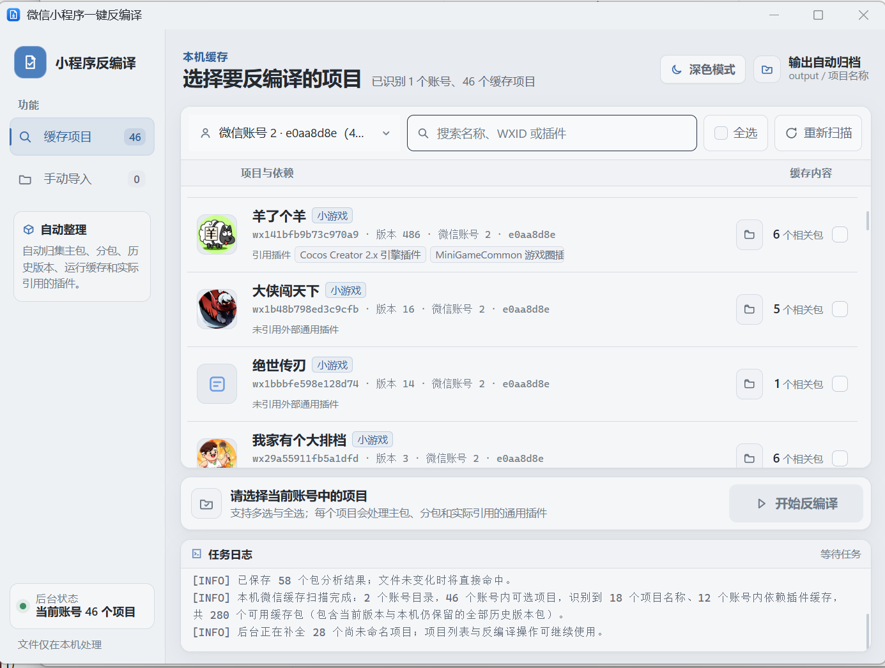
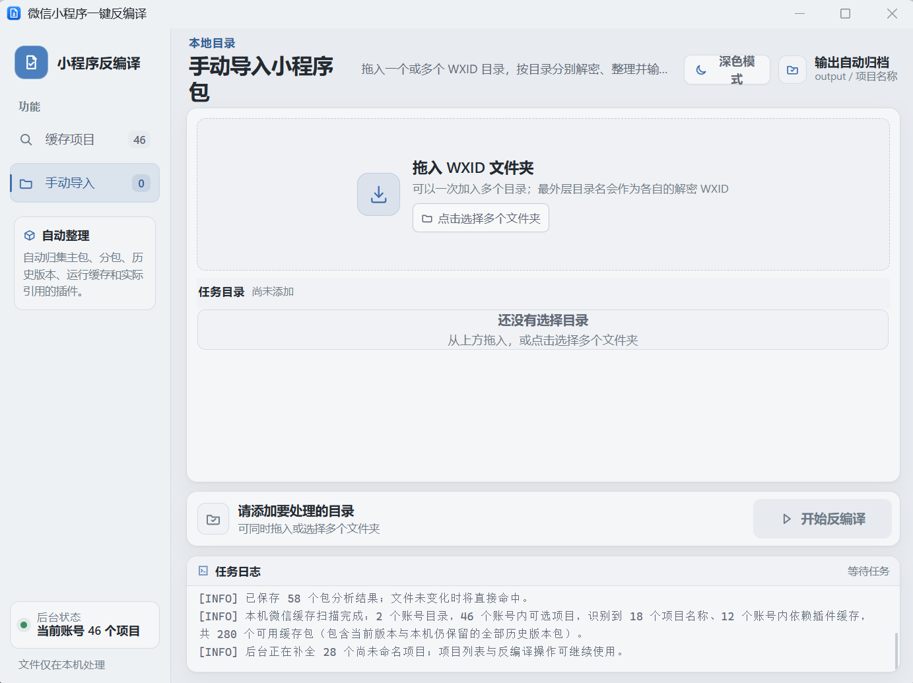

# wxminiunpack

<p align="center">
  
</p>

<p align="center">
  <strong>面向 Windows 的 C++20 + WebView2 wxapkg 批量反编译工具</strong><br>
  自动发现本机微信缓存，按小程序/小游戏聚合主包、分包、通用插件与运行时缓存，也支持手动导入多个 WXID 文件夹。
</p>

<p align="center">
  
  
  
  
</p>

> 这是一个本地优先工具。项目已移除软件层面的注册码、机器码绑定、授权存储、VMProtect SDK 与加壳流程；wxapkg 包本身可能使用的加密格式处理仍然保留，因为它是解包功能的一部分。名称补全优先读取本地缓存，部分公开元数据解析会按需访问网络；没有在线登录或在线授权。

## 功能亮点

- **自动扫描本机缓存**：枚举本机微信账号，识别账号目录、WXID、版本与缓存包。
- **按项目聚合**：同一个小程序/小游戏的主包、分包、实际引用的通用插件和运行时缓存归并为一个可选项目。
- **渐进式加载**：先显示已发现的包和图标，名称、依赖与运行时证据在后台补全，不阻塞首屏。
- **账号隔离**：先选择微信账号，再选择项目，避免不同账号的相同程序重复处理。
- **搜索、多选、全选**：支持按名称、WXID、插件和账号过滤，也可以一次处理多个项目。
- **手动导入**：拖入一个或多个最外层 WXID 文件夹；文件夹名作为对应 wxapkg 的 WXID。
- **完整性报告**：输出解包清单、缺失分包、依赖来源、处理状态和 `app-config.json` 证据。
- **现代桌面界面**：原生 C++ 窗口承载 WebView2 UI，支持浅色/深色主题、DPI 适配和高清拖放区域。
- **本地优先处理**：解包、合并和输出都在本机完成；名称补全优先使用本地证据，网络补全失败时仍可继续解包。

## 界面预览

### 自动扫描


### 手动导入



## 快速开始

### 运行环境

- Windows 10/11 x64
- Microsoft Visual Studio 2022/2026 Build Tools，安装 **Desktop development with C++**
- CMake 3.24 或更高版本
- Ninja
- Microsoft Edge WebView2 Evergreen Runtime

仓库已经携带 WebView2 C++ 头文件和 x64 静态加载库；运行时仍需要系统安装 WebView2 Evergreen Runtime。

### 编译

在 **x64 Native Tools Command Prompt for Visual Studio** 或已经加载 MSVC 环境的 PowerShell 中执行：

```powershell
cmake --preset windows-x64-release
cmake --build --preset windows-x64-release --parallel
ctest --preset windows-x64-release --output-on-failure
```

生成文件：

```text
build/release/微信小程序一键反编译.exe
```

创建可分发目录：

```powershell
cmake --install build/release --prefix build/package
```

### 直接运行

双击：

```text
build/release/微信小程序一键反编译.exe
```

程序启动后会先展示界面，再在后台扫描本机微信缓存。第一次扫描耗时与账号数量、缓存数量和磁盘速度有关；后续启动会复用本地索引。

## 使用方式

### 自动扫描本机缓存

1. 打开“缓存项目”。
2. 在账号下拉框中选择一个微信账号。
3. 使用搜索框按名称、WXID 或插件筛选。
4. 勾选一个或多个项目，或点击“全选”。
5. 点击“开始反编译”。
6. 结果会写入程序同目录下的 `output` 文件夹。

自动扫描会优先处理当前账号与当前版本的包，并把项目实际引用的通用插件随项目一并加入。声明在 `app-config.json` 中但本机尚未落盘的分包会记录到报告中，不会伪造不存在的文件。

### 手动导入

1. 打开“手动导入”。
2. 将一个或多个最外层 WXID 文件夹拖入导入区，或点击选择文件夹。
3. 检查任务列表，右上角的叉号可以取消单个目录。
4. 点击“开始反编译”。

每个导入目录的最外层文件夹名用于推导 WXID；目录内递归发现的所有 `.wxapkg` 会按同一个 WXID 尝试解密和合并。

## 输出规则

默认输出位置：

```text
<程序目录>/output/
```

单个自动识别项目通常使用项目名称作为目录名；多个项目或手动导入批次使用时间批次目录包裹：

```text
output/
├─ 20260804-143012/
│  ├─ 项目甲/
│  │  ├─ app.json
│  │  ├─ app-config.json
│  │  ├─ unpack-manifest.json
│  │  ├─ pages/
│  │  ├─ common/
│  │  └─ ...
│  └─ 项目乙/
└─ ...
```

每个项目目录可能包含：

| 文件/目录 | 用途 |
| --- | --- |
| `app.json` | 从 `app-config.json` 整理出的页面入口配置（存在有效配置时生成） |
| `app-config.json` | wxapkg 中的原始应用配置证据 |
| `unpack-manifest.json` | 输入包、WXID、依赖、分包完整性和处理状态 |
| `pages/`、`components/`、`common/` | 解出的源码与资源目录，实际以包内容为准 |
| `__PLUGINCODE__` 等目录 | 插件或分包解包结果 |
| `runtime-cache/` | 发现并纳入项目的运行时缓存文件（若有） |

缺失分包会在 `unpack-manifest.json` 的 `subpackagesNotPresentInLocalWxapkgCache` 中列出，并在运行日志中提示。`sourceCompleteness` 与 `analysisCompleteness` 用于区分“wxapkg 是否齐全”和“运行时缓存是否提供了补充证据”。

## 工作原理


源码分层：

- `native/src/wechat_cache_scanner.cpp`：微信账号、缓存、项目名称、图标与依赖发现。
- `native/src/wxapkg.cpp`：wxapkg 头部、索引、AES/PBKDF2 解密和文件读取。
- `native/src/batch_runner.cpp`：批次调度、包合并、依赖闭包、输出和清单。
- `native/src/reconstructor.cpp`：页面入口、配置和项目结构重建。
- `native/src/app.cpp`：Win32 窗口、WebView2 通信、拖放和后台任务。
- `native/resources/app.html`：内嵌的浅色/深色 WebView2 界面。

## 本地数据与隐私

程序不上传微信缓存，也不要求账号登录。运行时索引默认保存在：

```text
%LOCALAPPDATA%\微信小程序一键反编译\
```

主要内容包括：

- `app-name-map.json`：WXID 与已识别名称的本地映射。
- `package-analysis-v1\`：按路径、大小和修改时间复用的包分析缓存。
- `WebView2\`：WebView2 用户数据目录。

删除上述目录会清空本地索引和界面缓存，不会删除微信原始缓存。

## 常见问题

### 为什么日志提示某些分包缺失？

`app-config.json` 可能声明了分包，但微信只在实际使用或下载后才会把对应 wxapkg 写入本地。工具会处理现有包，并把声明但未落盘的名称写入清单；缺失的源文件不会被虚构。

### 为什么出现 `app-config.json was not found`？

当前项目包里没有找到有效的 `app-config.json`。工具仍会解出可读取的文件，并跳过依赖该配置的页面默认值生成；具体原因会写入日志和 `unpack-manifest.json`。

### 输出是完整的吗？

完整性分为两层：

1. **包源完整性**：本机是否存在主包、分包和实际引用插件的 wxapkg。
2. **分析完整性**：运行时缓存是否补充了 wxapkg 中没有的 Unity/WebGL/Wasm 或资源证据。

请以每个项目的 `unpack-manifest.json` 和日志为准。

### WebView2 启动时报错

安装或修复 Microsoft Edge WebView2 Evergreen Runtime 后重试。头文件和静态加载库已经随仓库提供，运行时组件仍由系统安装。

## 目录结构

```text
.
├─ .github/
│  ├─ ISSUE_TEMPLATE/
│  └─ workflows/
├─ docs/
│  ├─ ARCHITECTURE.md
│  ├─ BUILDING.md
│  ├─ OUTPUT_FORMAT.md
│  └─ assets/
├─ native/
│  ├─ include/wedecode/
│  ├─ resources/
│  ├─ src/
│  └─ tests/
├─ third_party/webview2/
├─ .gitattributes
├─ CMakeLists.txt
├─ CMakePresets.json
├─ CONTRIBUTING.md
├─ LICENSE
└─ README.md
```

## 贡献

欢迎提交问题、修复和新缓存样本的兼容性报告。提交前请阅读 [CONTRIBUTING.md](CONTRIBUTING.md)。

## 许可证

本项目使用 [GPL-3.0-or-later](LICENSE)。WebView2 SDK 的第三方许可与通知位于 [`third_party/webview2`](third_party/webview2)；完整说明见 [THIRD_PARTY_NOTICES.md](THIRD_PARTY_NOTICES.md)。
